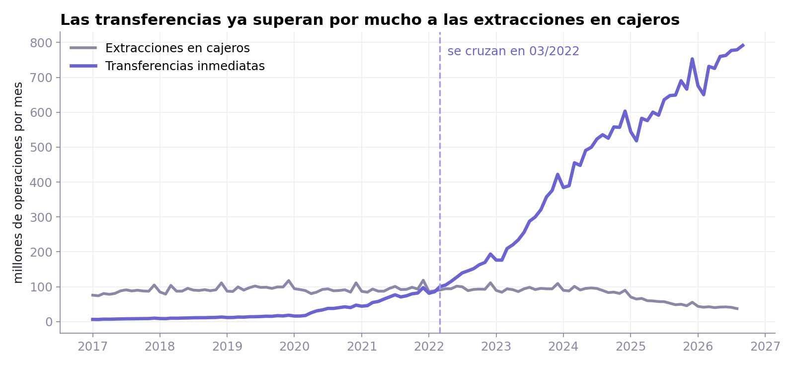
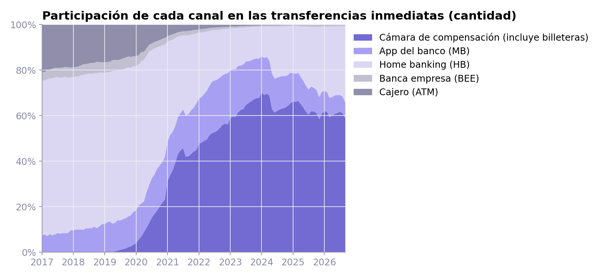
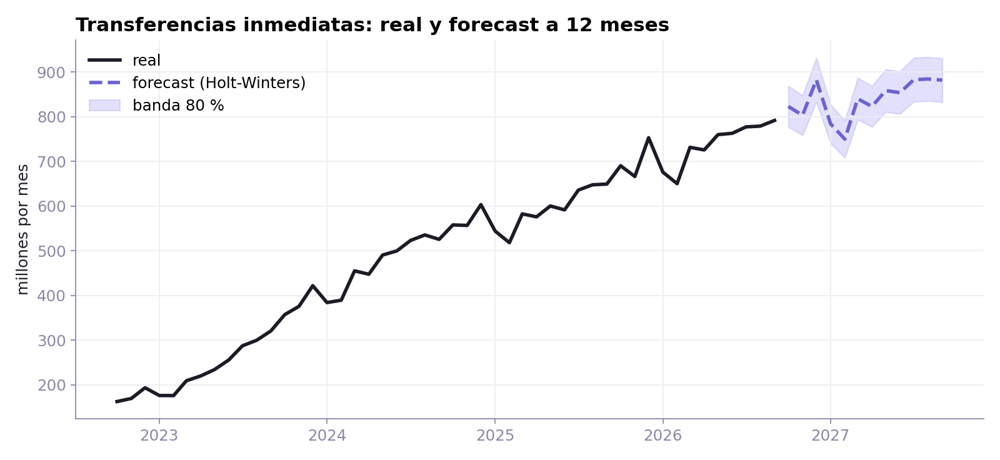

# Del cajero a la billetera: pagos digitales en Argentina con Python

Análisis con **datos oficiales del BCRA** (Informe Mensual de Pagos Minoristas) y el IPC del INDEC: cómo las transferencias, las billeteras y el QR reemplazaron al efectivo, y un **forecast a 12 meses** elegido por backtest.

👉 **[Ver el notebook con los resultados](notebooks/analisis.ipynb)**



## Hallazgos

| | |
|---|---|
| Transferencias por cada extracción en cajeros | de 0,08 (2017) a ~21 (2026) |
| Participación de la cámara de compensación (donde operan las billeteras) | de 0 % a ~59 % de las transferencias |
| Clientes con fondos comunes dentro de billeteras | de 10,7 M (2023) a 29,9 M (2026) |
| Pagos con QR, últimos 12 meses | +57 % interanual |
| Ticket real por transferencia | −93 % desde 2017: se usa para pagos chicos |
| Forecast próximos 12 meses | +15 % (Holt-Winters, 3,5 % de error en backtest) |



## Qué hace el código

```
src/bajar_datos.py      baja el Excel del BCRA y el IPC de datos.gob.ar
src/extraer.py          pasa 9 hojas con encabezados de varios niveles a una tabla larga (10.558 filas, 124 series)
src/armar_notebook.py   arma y ejecuta el notebook de análisis
notebooks/analisis.ipynb  análisis, gráficos y forecast
data/pagos_largo.csv    la tabla ordenada, lista para usar en Sheets, Power BI o SQL
```

- **Limpieza:** cada hoja del Excel tiene encabezados combinados en 2 o 3 niveles. `extraer.py` los reconstruye y genera una fila por fecha, serie y medida.
- **Control de calidad:** la suma de transferencias por canal coincide con el total que publica el BCRA (diferencia 0,0000 %).
- **Pesos constantes:** los montos se deflactan con el IPC nacional.
- **Forecast:** se comparan naive estacional, Holt-Winters y SARIMA. Se entrenan hasta septiembre 2025 y se miden contra 12 meses reales. El mejor se reentrena con toda la serie.



## Cómo correrlo

```bash
pip install -r requirements.txt
python src/bajar_datos.py 2026-09     # mes del informe del BCRA
python src/extraer.py
python src/armar_notebook.py
```

## Cómo usé Claude Code

- Encontrar dónde publica el BCRA las series en Excel y entender cada hoja.
- Escribir el parser de encabezados combinados y validar los totales.
- Comparar modelos de forecast y revisar que las conclusiones se sostengan con los datos.

## Fuentes

- BCRA, [Informe Mensual de Pagos Minoristas](https://www.bcra.gob.ar/), series a septiembre 2026.
- INDEC, IPC nivel general nacional, vía [API de Series de Tiempo](https://datos.gob.ar/series).

Nota: la cámara electrónica de compensación incluye las transferencias de billeteras con CVU, pero no solo esas. Se usa como aproximación del peso de las billeteras.

---
Milagros Sanabria · [mila-ops-ia.github.io](https://mila-ops-ia.github.io)
